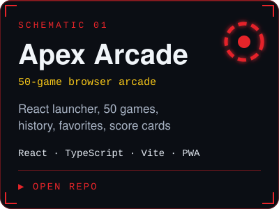
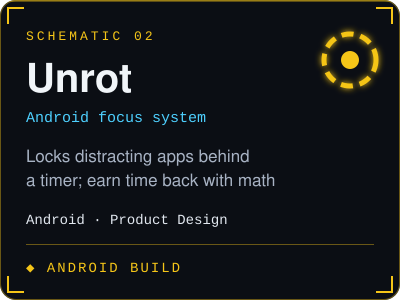
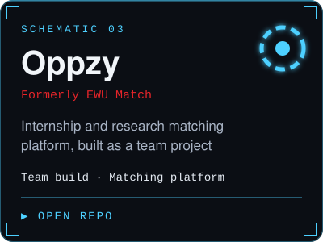

<div align="center">


[**LinkedIn**](https://linkedin.com/in/md-mahfujur-rahman-sujel) &nbsp;·&nbsp; [**GitHub**](https://github.com/md-mahfujur-rahman-sujel) &nbsp;·&nbsp; [**Apex Arcade**](https://github.com/md-mahfujur-rahman-sujel/Apex-Arcade) &nbsp;·&nbsp; [**Unrot**](https://github.com/md-mahfujur-rahman-sujel/Unrot)


</div>

```text
$ whoami
md-mahfujur-rahman-sujel

$ cat about.txt
BSc in Computer Science & Engineering, East West University, Bangladesh.
I turn product ideas into working systems: from the first sketch in Figma
to a shipped, polished release.
```


## `> projects --list`

<p align="center">
<a href="https://github.com/md-mahfujur-rahman-sujel/Apex-Arcade"></a>
<a href="https://github.com/md-mahfujur-rahman-sujel/Unrot"></a>
<a href="https://github.com/masum-mir/Oppzy"></a>
</p>


## `> stack --load`


## `> telemetry --live`

<p align="center">


</p>

<p align="center">

</p>


## `> pinned --repos`

<p align="center">
<a href="https://github.com/md-mahfujur-rahman-sujel/Apex-Arcade"></a>
<a href="https://github.com/md-mahfujur-rahman-sujel/Unrot"></a>
<a href="https://github.com/masum-mir/Oppzy"></a>
</p>


## `> tail -f activity.log`

<!--START_ACTIVITY-->
```text
2026-10-26  pushed 0 commit(s) to md-mahfujur-rahman-sujel/md-mahfujur-rahman-sujel
2026-10-26  created branch in md-mahfujur-rahman-sujel/md-mahfujur-rahman-sujel
```
<!--END_ACTIVITY-->


<div align="center"><sub><code>SYS ONLINE · READY FOR NEW MISSIONS</code></sub></div>
