<a href="https://linkedin.com/in/md-mahfujur-rahman-sujel">LinkedIn</a> &nbsp;·&nbsp; <a href="https://github.com/md-mahfujur-rahman-sujel">GitHub</a> &nbsp;·&nbsp; <a href="https://md-mahfujur-rahman-sujel.github.io">Website ↗</a>

Your friendly neighborhood developer. BSc in Computer Science & Engineering at East West University, Dhaka — I take product ideas end to end, from the first sketch in Figma to a shipped React, Spring Boot or Android release.

## Selected work

## Arsenal

## Pulse

## Case files

## Signals

<a href="https://github.com/md-mahfujur-rahman-sujel">full contribution graph on GitHub ↗</a>

East West University · Dhaka · <a href="https://github.com/md-mahfujur-rahman-sujel">github.com/md-mahfujur-rahman-sujel</a>

