 

## About

Your friendly neighborhood developer. BSc in Computer Science & Engineering at East West University, Bangladesh. I turn product ideas into working systems — from the first sketch in Figma to a shipped, polished release.

Frontend or full-stack: React and TypeScript on the surface, Spring Boot and Android underneath. Currently building in public and trying out new things.

## Projects

## Technology arsenal

## Telemetry

## Repositories

<a href="https://github.com/md-mahfujur-rahman-sujel/Apex-Arcade"><b>Apex-Arcade</b></a> ·
<a href="https://github.com/md-mahfujur-rahman-sujel/Unrot"><b>Unrot</b></a> ·
<a href="https://github.com/masum-mir/Oppzy"><b>Oppzy</b></a>

## Activity

<a href="https://github.com/md-mahfujur-rahman-sujel">full contribution graph on GitHub ↗</a>

East West University · Bangladesh · <a href="https://github.com/md-mahfujur-rahman-sujel">github.com/md-mahfujur-rahman-sujel</a>

