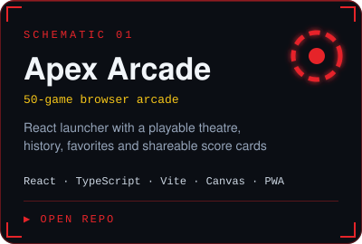
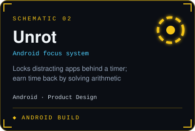
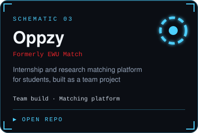

<div align="center">



[**LinkedIn**](https://linkedin.com/in/md-mahfujur-rahman-sujel) &nbsp;·&nbsp; [**GitHub**](https://github.com/md-mahfujur-rahman-sujel) &nbsp;·&nbsp; [**Apex Arcade**](https://github.com/md-mahfujur-rahman-sujel/Apex-Arcade)


</div>

```text
$ whoami
md-mahfujur-rahman-sujel

$ cat about.txt
BSc in Computer Science & Engineering, East West University, Bangladesh.
I turn product ideas into working systems: from the first sketch in Figma
to a shipped, polished release.
```


## `> projects --list`

<div align="center">
<table>
<tr>
<td><a href="https://github.com/md-mahfujur-rahman-sujel/Apex-Arcade"></a></td>
<td></td>
<td><a href="https://github.com/masum-mir/Oppzy"></a></td>
</tr>
</table>
</div>


## `> stack --load`


## `> telemetry --live`

<div align="center">


</div>


<div align="center"><sub><code>SYS ONLINE · READY FOR NEW MISSIONS</code></sub></div>
