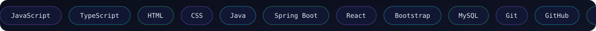

[**LinkedIn**](https://linkedin.com/in/md-mahfujur-rahman-sujel) &nbsp;·&nbsp; [**GitHub**](https://github.com/md-mahfujur-rahman-sujel) &nbsp;·&nbsp; [**Apex Arcade**](https://github.com/md-mahfujur-rahman-sujel/Apex-Arcade)

I'm a Computer Science & Engineering student at **East West University, Bangladesh**. I like turning product ideas into working systems — from the first sketch in Figma to a shipped, polished release.

## Projects

**[Apex Arcade](https://github.com/md-mahfujur-rahman-sujel/Apex-Arcade)** — React arcade launcher with 50 games, a playable theatre, local history, favorites, score-card sharing and deep links. &nbsp;**Unrot** — Android app that cuts mindless scrolling. &nbsp;**[Oppzy](https://github.com/masum-mir/Oppzy)** — internship and research matching platform (formerly EWU Match).

## Stack

## Activity

